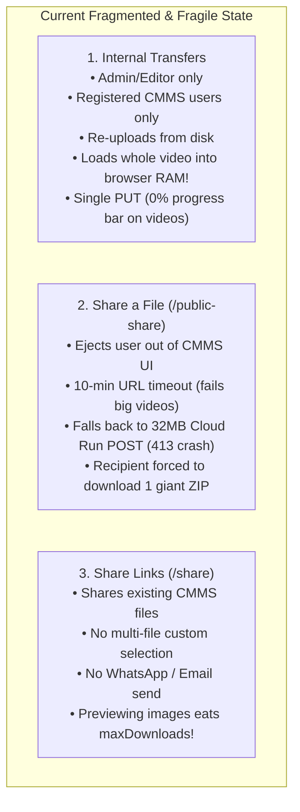
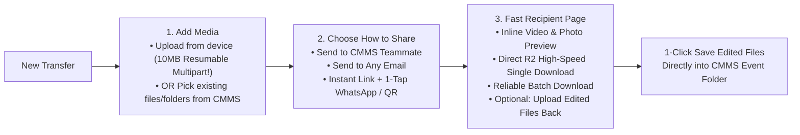

# Christhood CMMS — CTO Platform Audit & Master Improvement Proposal

**Date:** November 25, 2026  
**Prepared by:** Platform CTO Audit  
**Repository:** `Officialkid/christhood-storage-system`  
**Production Environment:** Google Cloud Run (`us-central1`) · Neon PostgreSQL · Cloudflare R2

---

## Executive Summary

Christhood CMMS has grown from a simple storage tool into an ambitious, full-featured Ministry Media Operating System — complete with hierarchical event media management, resumable cloud uploads, AI assistance (Zara), internal messaging, file transfers, external share links, public galleries, 2FA, and audit logging.

However, rapid feature growth has created **workflow disconnects, mobile friction, hardcoded dark-only styling (with a few jarring half-light screens), silent upload completion states, and a fragmented 3-way file transfer system** that struggles with large video files.

This document provides an honest, code-verified CTO assessment of:
1. **What the platform already does remarkably well** (and must be preserved).
2. **What is broken, disconnected, or underperforming** across UX, Mobile, Transfers, Bulk Delete/Trash, Security, and Performance.
3. **Concrete architectural proposals** for every pain point — including **Admin Bulk Delete with 13-day Trash retention**, **Clear Upload Completion UX**, **Transfers 2.0 (Unified WeTransfer-grade Video & Photo Sharing)**, **Mobile-First UI Polish**, and a **Balanced Light + Dark Theme System**.
4. **A clear, phased implementation roadmap** so improvements ship safely without regressions.

---

## 1. What We Have Done Well (Core Strengths to Preserve)

Before fixing what isn't working, it is important to recognize what is genuinely strong in the current codebase:

| Area | What Works Well | Codebase Evidence |
|---|---|---|
| **Zero-Quality-Loss Media Contract** | Original photos and videos are never recompressed or degraded in Cloudflare R2. Thumbnails/previews are stored under separate keys while originals remain byte-for-byte intact. | `prisma/schema.prisma`, `lib/r2.ts` |
| **Resilient Main Upload Engine** | Files ≥ 10 MB automatically split into parallel multipart chunks with IndexedDB session persistence, active `/api/ping` network checks, duplicate detection, and retry/resume support. | `components/UploadZone.tsx`, `lib/upload/multipart-uploader.ts` |
| **Simplified Event & Day Folders** | Creating an event from the Dashboard or Events Library with optional dates, custom `"Other"` categories, and inline `Day 1 / Day 2 / Day 3` folders now works in one step. | `components/CreateEventModal.tsx`, `components/EventFolderBar.tsx` |
| **Zara AI Governance & Safety** | 5-tier risk classification (`SAFE` → `CRITICAL`), explicit impact confirmation cards, pre-action snapshots for rollback, and PII-sanitized logs are thoughtfully engineered. | `lib/assistant/safety/action-classifier.ts` |
| **Soft-Delete Trash Safety Net** | Deleted files move to `TrashItem` before permanent R2 purge, preserving `preDeleteStatus` so accidental deletions can be restored cleanly. | `prisma/schema.prisma`, `app/api/admin/trash/` |
| **Security Primitives** | AES-256-GCM encryption for TOTP secrets, bcrypt cost-12 password hashing, CRLF header injection protection, and multi-stage non-root Docker builds on Cloud Run. | `middleware.ts`, `lib/totp.ts`, `Dockerfile` |

---

## 2. Priority Pain Points: Root-Cause Diagnosis & Proposed Solutions

### 2.1 Admin Bulk Delete, Verification & 13-Day Trash Retention

#### What Is Happening Right Now (Root Causes)
1. **Bulk Delete already exists in code — but was never wired into Event pages!**
   - `components/MediaGrid.tsx` already implements multi-select checkboxes, `Select All`, a sticky selection bar, and verified batch deletion via `components/DeleteFileDialog.tsx` → `POST /api/files/batch-delete`.
   - **However, `app/(dashboard)/events/[eventId]/page.tsx` renders raw `<MediaCard>` items inside a plain `
` instead of `<MediaGrid>`!**
   - Because of this:
     - Admins **cannot select multiple files or bulk delete** inside any Event or Day folder (`Day 1`, `Day 2`, `Day 3`).
     - Hovering a card on an Event page shows a ghost checkbox that **does nothing when clicked** (`onToggleSelect` is `undefined`).
     - Clicking a photo/video card on an Event page **does not open the preview lightbox** (`onPreview` is `undefined`).
     - Deleting a single file inside an Event page doesn't even refresh the grid (`onDeleted` is `undefined`).
2. **Batch Delete limit of 100 files**:
   - `POST /api/files/batch-delete` rejects selections over 100 files (`HTTP 422`) instead of chunking large selections automatically.
3. **Admin Trash page has no bulk restore or bulk permanent delete**:
   - In `/admin/trash`, Admins must restore or permanently purge files one by one, and confirmations use raw browser `window.confirm()` popups.
4. **Trash retention is hardcoded to 30 days across 8 API routes (ignoring Admin Settings!)**:
   - Even though Admin Settings has a `trash_retention_days` setting, all 8 delete endpoints hardcode `30 * 24 * 60 * 60 * 1000` (30 days).
   - Additionally, `app/api/admin/maintenance/route.ts` (`run_trash_purge`) marks files `PURGED` in PostgreSQL **without deleting the object from Cloudflare R2** — leaking cloud storage!

#### Proposed Solution
- **Mount `<MediaGrid>` inside `events/[eventId]/page.tsx` (and `ArchiveSection`)**:
  - Instantly unlocks **Select Mode / Select All / Bulk Delete / Bulk Status Change / Fullscreen Lightbox Preview** inside every Event and Day folder.
  - Add an explicit **"Select Files"** toggle button in the Event/Media toolbar so Admins on both desktop and mobile can tap-to-select effortlessly (without needing hover or hidden long-press).
- **Verified Bulk Delete Modal (`DeleteFileDialog`)**:
  - Shows exact count of selected photos/videos, total storage size, a warning if any `PUBLISHED` files are included, and requires explicit confirmation before moving them to Trash.
  - Automatically chunks requests in batches of 100 if an Admin selects 250+ files at once.
- **13-Day Trash Retention Everywhere**:
  - Centralize retention in a single helper `getTrashRetentionDays()` defaulting to **13 days** (and honoring `AppSetting.trash_retention_days` if customized by Admin).
  - Update all delete endpoints so `scheduledPurgeAt = deletedAt + 13 days`. After 13 days, the daily `/api/cron/purge` job permanently removes both the database record and R2 objects (original + thumbnail + versions).
  - Fix the R2 storage leak in `app/api/admin/maintenance/route.ts` and add **Bulk Restore / Bulk Delete Permanently / Empty Expired** to `/admin/trash`.

---

### 2.2 Upload Completion Feedback ("Queue Finishes Silently")

#### What Is Happening Right Now (Root Causes in `components/UploadZone.tsx`)
1. **Progress Summary Vanishes the Instant Uploads Finish**:
   - At line 1198, as soon as the upload worker pool finishes, `setIsUploading(false)` runs.
   - Because the overall progress card is gated on `{isUploading && filesState.length > 1}`, **the progress card disappears from the screen the exact millisecond the upload completes!** (And for a 1-file upload, it never appeared at all.)
2. **Misleading Queue Header**:
   - Line 1721 always displays `"X files queued"` — even when all `X` files have finished uploading!
3. **Faded Grey Disabled Button at the Bottom**:
   - Lines 1803–1820 disable the button with `disabled:opacity-40` and show a sync/reload icon (`RefreshCw`) next to `"All done"`. Visually, it looks stuck or inactive rather than completed.
4. **Mobile Screen Sleep Pauses Video Uploads**:
   - `UploadZone.tsx` warns mobile users *"Keep this page open"*, yet never requests the browser **Screen Wake Lock API** (`navigator.wakeLock.request('screen')`), so phones dim and lock mid-upload during large videos.
5. **Unnecessary Two-Step "Set Destination" Button**:
   - Users select Year → Category → Event, then have to remember to also tap `"Set destination"` before the Upload button unlocks.

#### Proposed Solution
- **Prominent Upload Complete Banner & Summary Card**:
  - When the queue finishes, transition the progress card into a bright, unmistakable **Upload Complete Banner**:
    - Emerald checkmark + **"All 14 files uploaded successfully to Jewels Kids Camp → Day 1!"** (total size + time taken).
    - If any file failed (e.g. 13 succeeded, 1 failed), show an amber partial-completion banner with a 1-click **"Retry 1 Failed File"** button.
  - Provide two immediate action buttons right on the completion card:
    1. **`Open Folder (Day 1) →`** — takes you straight to `/events/[eventId]?subfolder=[subfolderId]` to see your uploaded videos.
    2. **`Upload More Files`** — clears the completed list cleanly while keeping your folder selected (or lets you click `Day 2` right above to upload the next batch).
- **Dynamic Queue Header**:
  - Updates live from `"14 files ready to upload"` → `"Uploading 6 of 14 files (43%)…"` → **`"✓ 14 of 14 files uploaded"`**.
- **Toast Notification + Automatic Screen Wake Lock + Instant Destination**:
  - Trigger an in-app toast notification upon completion, hold `navigator.wakeLock` automatically while `isUploading` is active on mobile, and auto-apply the destination as soon as an Event/Day is chosen (removing the extra `"Set destination"` button click).

---

### 2.3 Fixing Transfers Once and For All ("Christhood Transfer Hub")

#### Why Transfers Has Been Failing & Frustrating in Practice
Our audit of `Transfers`, `Share a File (/public-share)`, and `Share Links (/share)` uncovered **5 major technical & UX reasons** why sending videos/photos has not worked as intended:

1. **Browser RAM Crashes & Stuck `0%` Progress on Large Videos (`NewTransferForm.tsx`)**:
   - Before uploading, `NewTransferForm` reads the **entire video into browser RAM** (`await file.arrayBuffer()`) to compute SHA-256, crashing mobile browsers and laptops on 1–4 GB videos.
   - Then it uploads via a single `fetch(..., { method: 'PUT' })` — which **cannot report upload progress** (staying stuck on `"Uploading 0 / 1 files"` for 20+ minutes) and restarts from `0%` if the network blips!
2. **Corrupted Downloads & Cloud Run 5-Minute Timeouts**:
   - Individual download endpoints in Transfers and Share Links omit `originalName` (`ResponseContentDisposition`) when presigning R2 URLs — so clicking "Download" or "Download All" opens videos in the browser tab or gets blocked by Chrome/Safari popup blockers!
   - Server-streamed ZIP endpoints run inside Cloud Run's **hard 300-second (5-minute) timeout** and open all R2 file streams simultaneously in 1 GiB RAM (plus `/t/[code]` tries to CPU-compress MP4 videos at `zlib level 9`!), truncating large video downloads mid-stream!
3. **Broken Navigation Links**:
   - Clicking `"View sent transfer"` or clicking any Transfer notification routes to `/communications/transfers/sent/<id>`, which the catch-all route swallows — dumping you back onto the list view instead of opening the transfer!
4. **Cannot Send Existing CMMS Media Without Re-Uploading**:
   - If videos are already in `Jewels Kids Camp → Day 1`, you can't pick them in a Transfer — you have to download them and re-upload them from disk. Conversely, when an editor sends edited videos back, you can't click `"Save to Event"` — you have to download and re-upload again!
5. **Three Confusing, Overlapping Tools**:
   - Users don't know whether to use **Transfers**, **Share a File** (which abruptly leaves the dashboard), or **Share Links**.

#### Proposed Solution: Unified "Christhood Transfer Hub" (WeTransfer Simplicity + Ministry Power)

Consolidate file sending into **one effortless, rock-solid workflow** inside `Transfers` (accessible from the sidebar and mobile bottom bar):

1. **Powered by the Resumable Multipart Engine**:
   - Reuse CMMS's proven 10 MB chunked multipart uploader for Transfers — giving **real-time % progress, MB/s speed, ETA, pause/resume, Wake Lock, and zero browser RAM crashes** even on 10 GB 4K videos.
   - Accept all creative/media formats (`.mp4`, `.mov`, `.mkv`, `.jpg`, `.png`, `.cr2`, `.nef`, `.arw`, `.dng`, `.wav`, `.mp3`, `.zip`, `.prproj`, `.drp`) with clear feedback instead of silent drops.
2. **Send Fresh Uploads OR Existing CMMS Files**:
   - Tab 1: **Upload from Device** (files or whole folders).
   - Tab 2: **Pick from CMMS Library** (select files from `Jewels Kids Camp → Day 1` with **zero re-uploading** — instant R2 reference!).
3. **Share With Anyone (Internal OR External in One Place)**:
   - **Link Mode (Default — like WeTransfer)**: Generates a clean short link (`/t/[code]`) immediately upon upload with **Copy Link**, **Share via WhatsApp**, **Native Mobile Share Sheet (`navigator.share`)**, and **Send via Email**, plus optional **PIN protection** and **Expiry (7 / 14 / 30 days)**.
   - **Teammate Mode**: Assigns directly to a CMMS Editor/Admin/Uploader with in-app + push + email alerts and enables **"Request Edited Files Back"** (round-trip workflow, with a **1-click "Save Response to Event Folder"** button when edited files return!).
4. **Bulletproof Downloads (Zero Cloud Run 300s Timeouts)**:
   - Fix `ResponseContentDisposition: attachment; filename=...` on every presigned R2 URL so single-file downloads **always save directly from Cloudflare R2 at maximum network speed** with original filenames.
   - For multi-file "Download All", stream sequentially on the client (or stream sequentially one-file-at-a-time with `STORE` zero-compression for <1 GB bundles, and direct multi-file R2 download manager for multi-GB video bundles) so Cloud Run **never** runs out of RAM or hits the 5-minute timeout.
   - Fix all broken `/communications/transfers/.../[id]` links and unread badge counts for Editors & Admins.

---

### 2.4 Balanced Light Mode + Dark Mode Design System

#### Why Light Mode Cannot Be "Bolted On" Carelessly
Right now:
- **107 UI files** hardcode dark Tailwind classes (`bg-slate-950`, `bg-slate-900`, `bg-slate-800`, `text-white`, `border-slate-800`).
- Meanwhile, **`ChatbotWidget.tsx` and `/public-share` already mix light white panels (`bg-white`) with dark headers (`bg-slate-900`)**, and native `<select>` dropdowns pop up blinding white menus inside dark forms on Windows/Android!
- If we simply add `dark:` classes piecemeal, missed components will leave ugly half-dark / half-light screens. Conversely, if we blindly invert `text-white`, solid buttons (`bg-indigo-600 text-white`) and photo thumbnail overlays will become unreadable!

#### Proposed Solution: Semantic Design Token Architecture (100% Balanced Light & Dark)

We will introduce a **Semantic CSS Variable Token Layer** in `app/globals.css` + `tailwind.config.js`, paired with a flash-free `ThemeProvider` (`Light` · `Dark` · `System`, with a 1-click toggle in the TopBar & Profile).

Every surface, border, text hierarchy, and badge uses semantic tokens that automatically harmonize across the entire platform:

| Semantic Token | Purpose | Light Mode (Clean Daylight Studio) | Dark Mode (Balanced Midnight Slate) |
|---|---|---|---|
| `bg-canvas` | Main app background | `#F8FAFC` (`slate-50` — soft, zero glare) | `#020617` (`slate-950`) |
| `bg-surface` | Cards, Sidebar, Modals, TopBar | `#FFFFFF` (`white` with subtle shadow) | `#0F172A` (`slate-900`) |
| `bg-elevated` | Inputs, pills, hover states, sub-cards | `#F1F5F9` (`slate-100`) | `#1E293B` (`slate-800`) |
| `bg-muted` | Badges, subtle dividers, skeleton | `#E2E8F0` (`slate-200`) | `#334155` (`slate-700`) |
| `border-line` | Card & section borders | `#E2E8F0` (`slate-200`) | `rgba(30, 41, 59, 0.8)` (`slate-800/80`) |
| `border-line-strong` | Input & interactive borders | `#CBD5E1` (`slate-300`) | `#334155` (`slate-700`) |
| `text-fg` | Primary headings & titles | `#0F172A` (`slate-900` — crisp contrast) | `#F8FAFC` (`slate-50`) |
| `text-fg-secondary` | Body copy & active nav labels | `#334155` (`slate-700`) | `#CBD5E1` (`slate-300`) |
| `text-fg-muted` | Subtitles, metadata, timestamps | `#64748B` (`slate-500`) | `#94A3B8` (`slate-400`) |
| `Brand Primary` | Primary CTAs & active accents | `#4F46E5` (`indigo-600`, `text-white`) | `#6366F1` (`indigo-500`, `text-white`) |

**Guarantees of this architecture:**
1. **Zero Half-Light / Half-Dark Screens**: Sidebar, TopBar, Mobile Bottom Nav, Dashboard, Events, Media Cards, Upload, Transfers, Modals, Auth pages, and Zara Chat Widget all pull from the exact same semantic tokens.
2. **Native Controls Match Automatically**: Setting `color-scheme: light` / `color-scheme: dark` on `:root` ensures native date pickers, `<select>` menus, and scrollbars match the active theme on Windows, macOS, iOS, and Android.
3. **Media Thumbnails & Brand Buttons Stay Crisp**: Solid brand buttons (`bg-indigo-600 text-white`) and dark gradient overlays on photo/video thumbnails intentionally preserve high-contrast white icons/badges in both themes.
4. **Zero White Flash on Page Load**: A tiny synchronous inline script in `<head>` applies the user's saved theme before first paint and updates `<meta name="theme-color">` for mobile PWA status bars.

---

## 3. Mobile UI & UX Excellence Plan

Right now, mobile works, but several desktop-first patterns make it harder to use in the field (especially for photographers/videographers uploading from phones at camps and fellowships):

### Current Mobile Pain Points Found in Code
1. **Bottom Navigation (`MobileBottomNav.tsx`) Misses the Most Important Actions**:
   - Currently shows: `Home` · `Media` · `Transfers` · `Alerts` · `Menu`.
   - **`Alerts`** duplicates the bell icon already at the top right of `TopBar`!
   - **`Menu`** duplicates the hamburger menu already at the top left of `TopBar`!
   - Meanwhile, **`Events`** (where Day 1 / Day 2 / Day 3 folders live!) and **`Upload`** (the #1 mobile task!) require opening the side drawer!
2. **Broken iPhone Safe-Area Padding & `100vh` Clipping**:
   - `MobileBottomNav.tsx` uses `className="safe-pb"` and `InstallBanner.tsx` uses `safe-area-inset-bottom`, **neither of which is defined in `globals.css`** — causing the bottom bar to collide with the iPhone Home Indicator!
   - `app/(dashboard)/layout.tsx` uses `h-screen` instead of `h-[100dvh]`, causing mobile browser address bars to clip bottom content.
3. **Layout Overflow on Events Pages (`app/(dashboard)/events/layout.tsx`)**:
   - Applies `-m-8` (`-32px` negative margin) inside a `<main>` that only has `p-4` (`16px` padding) on mobile — pulling content off-screen and canceling bottom-nav clearance! Also, tapping an event in the mobile FolderTree drawer doesn't auto-close the drawer.
4. **Desktop-Only Hover Controls on `MediaCard.tsx`**:
   - The `⋯` action menu (`pointer-events-none opacity-0`) and selection checkbox rely on mouse hover! On touchscreens, users can't easily tap `⋯` or select multiple files.
5. **iOS Safari Auto-Zoom on Input Focus**:
   - Inputs and dropdowns use `text-xs` (`12px`) or `text-sm` (`14px`), causing iOS Safari to forcefully zoom in the whole screen every time you tap Search, Event Title, or Filters. Using `text-base sm:text-sm` (`16px` on mobile, `14px` on desktop) eliminates iOS auto-zoom completely.
6. **Floating Zara Button Overlap & Cramped Modals/Tables**:
   - The floating `Help` button (`bottom-20 right-5`) sits right on top of bottom-right action buttons and pagination on phones.
   - `NotificationBell.tsx` has a `6×6px` push-toggle dot right under the bell that is nearly impossible to tap intentionally.
   - `admin/logs/page.tsx` renders a wide 5-column desktop table with no mobile card view, and `PreviewModal.tsx` squeezes metadata on portrait phone screens.

### Proposed Mobile Redesign
- **Upgraded 5-Tab Mobile Bottom Bar**:
  - **`Home`** (`/dashboard`) · **`Events`** (`/events`) · **`+ Upload`** (`/upload` — elevated center accent button) · **`Transfers`** (`/communications/transfers/inbox`) · **`Media`** (`/media`).
  - Keep **Search**, **Theme Toggle**, **Alerts Bell**, and **Menu Drawer** cleanly organized in the sticky `TopBar` (all with proper `44×44px` minimum touch targets).
- **True Native-App Feel on Phones**:
  - Define proper `env(safe-area-inset-top)` and `env(safe-area-inset-bottom)` utilities and switch `100vh` → `100dvh` across the shell.
  - Fix `events/layout.tsx` mobile margins (`-m-4 sm:-m-6 md:-m-8`) and auto-close the FolderTree drawer on navigation.
  - Make `MediaCard` mobile-first: always-tappable `⋯` button on touch devices, visible checkboxes whenever "Select Mode" is active, and stop preloading 48 full video files over mobile data on grid load!
  - Put Upload Destination + Mobile Capture (`Gallery` / `Take Photo` / `Record Video`) above the fold on mobile `/upload`.
  - Convert wide tables (`Activity Log`, `Trash`) to clean stacked cards on `< md` screens, upgrade `PreviewModal` with swipe left/right navigation and scrollable bottom sheet details, and tuck/minimize the floating Help FAB cleanly so it never blocks primary buttons.

---

## 4. Additional High-Impact CTO Findings (Security, Performance & Product)

During the deep audit of the repository, several important backend, security, and performance issues were also identified that we should address to make the platform rock-solid:

### A. Critical Security Fixes
1. **2FA Cookie Verification Bypass (`middleware.ts:268`)**:
   - `/api/auth/2fa/verify` signs an HMAC `2fa_verified` cookie, but `middleware.ts` only checks if the cookie is non-empty (`if (!verifiedCookie)`) without verifying its HMAC signature or `userId`! **Fix:** Verify the HMAC signature + `userId` + expiry in `middleware.ts` via Web Crypto (`crypto.subtle`).
2. **Deactivated Users Keep Active JWT Sessions (`lib/auth.ts` & `deactivate/route.ts`)**:
   - Deactivating a user deletes DB `Session` rows, but NextAuth is configured with stateless 30-day JWTs — so deactivated accounts stay logged in! **Fix:** Re-verify `isActive` + `role` periodically in the JWT callback and honor `session_timeout_minutes`.
3. **Password-Protected Gallery Download Bypass & Transfer PIN Bypass**:
   - Public gallery download routes (`/api/gallery/public/[galleryId]/files/[fileId]/download` and `/download-all`) and Transfer download routes (`/api/transfers/[id]/files/[fileId]`) do not verify the password/PIN cookie server-side! **Fix:** Enforce HMAC cookie verification on all protected download routes, and secure `/api/public-share/notify` against unauthenticated email spam/HTML injection.

### B. Major Performance & Stability Wins
1. **Prevent Cloud Run OOM Crashes on Video Thumbnails (`lib/thumbnail.ts:98`)**:
   - Currently downloads the **entire multi-hundred-MB video into Node RAM + `/tmp` (also RAM on Cloud Run)** just to extract 1 frame at `00:00:01`, risking instant `1Gi` container crashes! **Fix:** Pass a short-lived presigned R2 URL directly to `ffmpeg(presignedUrl)` (which uses HTTP Range requests to read < 2 MB!) and respect `process.env.FFMPEG_PATH` (`/usr/bin/ffmpeg` on Alpine).
2. **Make Thumbnail Presigned URLs Cacheable (`lib/r2.ts:46`)**:
   - Because `getPresignedDownloadUrl` signs with the exact current second, every 15-second dashboard refresh and page navigation generates brand-new URLs for the same thumbnails, forcing browsers to re-download images repeatedly! **Fix:** Round signing timestamps to 15-minute intervals (`expiresIn: 3600`) so browser disk caching makes repeat page loads instant, and add pagination to `/events/[eventId]`.

### C. Product Consistency & Cleanup
1. **Wire Up (or Streamline) Admin Settings (`app/(dashboard)/admin/settings/page.tsx`)**:
   - Currently, **44 out of 45 toggles/inputs** in Admin Settings save to PostgreSQL (`AppSetting`) and show `"✓ Saved"`, **but are never read anywhere in the app** (only `archive_threshold_months` is wired up!). **Fix:** Build a cached `getAppSettings()` service to wire core settings (`trash_retention_days`, `system_name`, `max_file_size_mb`, `zara_enabled`, `transfer_expiry_days`, `session_timeout_minutes`, etc.) into real runtime behavior, and remove/hide any unused placeholder settings so Admins can trust every control.
2. **Search & Documentation Polish**:
   - Make `/search` cards open the media file/preview directly (instead of dumping users into the parent Event folder to hunt for the file), add the missing Event filter dropdown in `SearchFilters.tsx`, and show recent files when opening `/search`.
   - Fix Zara's Uploader permission check in `lib/assistant/tools/read-tools.ts` (currently conflates `FolderFollow` with event access) and persist Zara action confirmations in PostgreSQL (`ZaraActionLog`) so multi-instance Cloud Run scaling never loses pending confirmations.

---

## 5. Recommended Phased Execution Plan

To deliver maximum value quickly and safely without disrupting active ministry work, I recommend executing this in **4 focused phases**:

| Phase | Scope | Key Deliverables |
|---|---|---|
| **Phase 1: Immediate Workflow Fixes** | Bulk Delete + 13-Day Trash + Upload Completion | • Enable `<MediaGrid>` + Select Mode + Bulk Delete dialog on all Event & Day pages • Set Trash retention to **13 days** across all delete routes + fix maintenance R2 purge leak + add Bulk Restore/Purge in `/admin/trash` • Add unmistakable **Upload Complete Banner** (`Open Folder` + `Upload More`), live queue header counts, Screen Wake Lock, and 1-step destination on `/upload` |
| **Phase 2: Transfers 2.0 ("Christhood Transfer Hub")** | Reliable Video/Photo Sharing (Internal + External) | • Upgrade Transfers to use the **10 MB resumable multipart R2 uploader** (live % progress, speed/ETA, zero browser RAM crashes) • Allow sending **fresh uploads OR existing CMMS Event/Media files** without re-uploading • Unify sharing: send to CMMS teammates, Email, **1-tap WhatsApp**, or Copy Link (`/t/[code]`) with enforced PINs • Fix cross-origin R2 `Content-Disposition` downloads, eliminate 300s Cloud Run ZIP timeouts, fix broken notification links, and add 1-click **"Save Edited Files to Event"** |
| **Phase 3: Balanced Light/Dark Mode & Mobile UI Overhaul** | Visual Harmony + Field-Ready Mobile UX | • Introduce semantic CSS-variable tokens (`canvas`, `surface`, `elevated`, `line`, `fg`) + `ThemeProvider` (`Light` / `Dark` / `System` toggle in TopBar) • Audit and migrate all surfaces (including `ChatbotWidget`, modals, dropdowns, auth pages) so zero screens mix light & dark • Upgrade Mobile Bottom Nav (`Home · Events · +Upload · Transfers · Media`), fix iPhone `safe-area` & `100dvh`, fix Events `-m-8` overflow, eliminate iOS input zoom, and make `MediaCard` touch-first |
| **Phase 4: Security, Performance & Settings Hardening** | CTO Reliability & Scale | • Enforce HMAC verification on `2fa_verified`, gallery password downloads, and transfer PINs; revoke JWTs for deactivated users • Switch video thumbnail extraction to HTTP Range streaming (preventing Cloud Run OOM) + 15-min bucketed presigned URLs for instant browser caching • Wire `Admin → Settings` controls to real backend behavior + upgrade Search direct-file preview & Zara multi-instance persistence |

---

## 6. Decisions to Confirm Before We Begin Implementation

1. **Phase Order**: Would you like to start right away with **Phase 1 + Phase 2 + Phase 3** (or execute all 4 phases sequentially)?
2. **Trash Retention Period**: Confirm **13 days** as the new default before permanent deletion (and wired to `Admin → Settings` so you can also adjust it anytime).
3. **Default Theme Preference**: Should the platform default to **System preference** (automatically Light during the day / matching the user's device, with a 1-tap Light/Dark toggle in the top bar), or default to **Light** / **Dark** for first-time visitors?
4. **Who Can Send Transfers**: Should **all logged-in team members** (`ADMIN`, `EDITOR`, and `UPLOADER`) be able to send transfers/links from the unified Transfer Hub, or only `ADMIN` and `EDITOR`?
